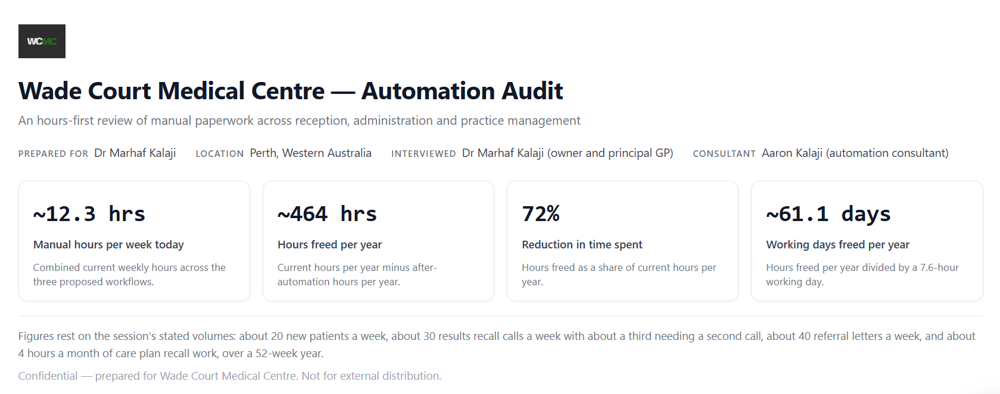
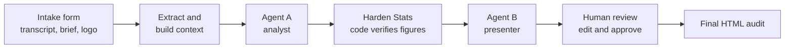
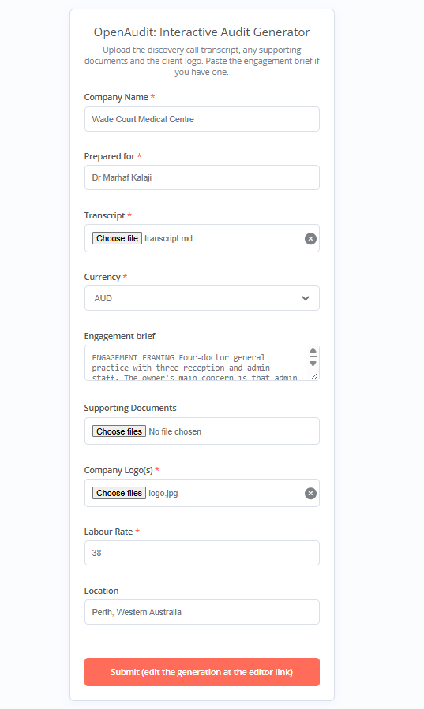
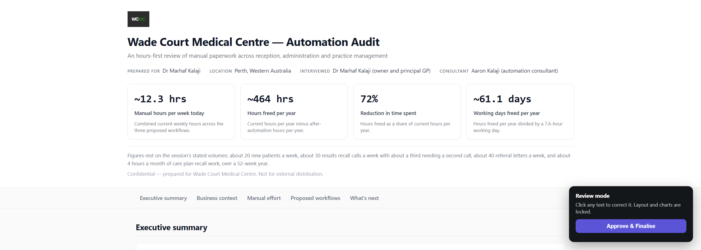
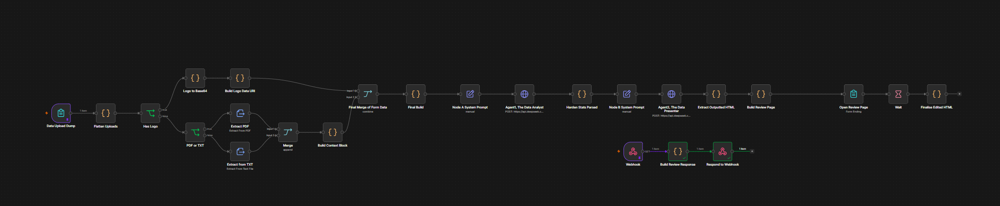

# OpenAudit

**Turn a discovery-call transcript into a client-ready, interactive automation audit.**

OpenAudit is an n8n pipeline I designed and built solo during my AI & Automation internship at Eloize. You upload a sales or discovery call transcript, and it produces a self-contained HTML audit: where the client's staff time goes, the three automations worth doing first, and how many hours each one frees. A consultant reviews and approves it before anything reaches the client.

**[View the live example audit →](https://aaronkal-ecu.github.io/open-audit/examples/wade-court/output.html)**



## Used on a real client

OpenAudit produced the audit Eloize pitched to a Perth food-delivery business. After seeing it, the client hired Eloize to automate parts of the businesses systems.

That audit covered:

| | |
|---|---|
| Workflows quantified | 3, plus 5 supporting flows and 1 next-phase item |
| Pain points identified | 4 |
| Manual handling today | ~67 hrs/yr |
| After automation | ~19 hrs/yr |
| Time freed | **~48 hrs/yr, a 72% reduction** |

Client details are withheld. See the [anonymised case study](docs/case-study.md) for the per-workflow breakdown.

## What it does



1. **Intake.** A form takes the transcript, any supporting documents, the client logo, the labour rate and an optional engagement brief.
2. **Extraction.** PDFs and text files are extracted and assembled into one context block, with the transcript first as the primary evidence.
3. **Agent A, the analyst.** It reads the material and returns strict JSON: the three strongest workflows, pain points, supporting flows, next-phase items and the raw inputs for every figure. Each claim is marked `verified` or `estimate`.
4. **Harden Stats.** A code node recomputes every hours figure, total and percentage from those raw inputs, rejects impossible values and resolves the headline KPIs. The model never does the arithmetic that reaches the client.
5. **Agent B, the presenter.** It builds a single-file interactive dashboard from the hardened data, with charts, expandable workflow cards and before/after process maps.
6. **Human review.** The submitter is redirected to an in-browser editor. Nothing is final until a person approves it, and the approved file is re-validated before download.

## Design principles

- **The LLM judges, code does the maths, a human approves.** Language models are good at reading a messy conversation and deciding what matters, and unreliable at sums. Each job goes to the part that does it well. [More in design decisions](docs/design-decisions.md).
- **Hours first.** The audit leads with time freed, not invented dollar savings.
- **Honest confidence.** Every figure carries a `VERIFIED` or `EST.` marker traced back to the transcript.
- **Grounded, not padded.** Exactly three quantified workflows. Smaller ideas become supporting flows with no figures attached.

## Quick start

1. Import [`workflows/openaudit-v4.1.json`](workflows/openaudit-v4.1.json) into n8n.
2. Add a DeepSeek API key as a Header Auth credential on both agent nodes.
3. Set your n8n host in the **Build Review Page** node, then activate the workflow.
4. Open the form's production URL and submit the files in [`examples/wade-court`](examples/wade-court).

Full instructions are in [docs/setup.md](docs/setup.md).

## Example run

[`examples/wade-court`](examples/wade-court) contains a complete synthetic engagement: a discovery call with a GP clinic owner whose admin staff are stuck on repetitive paperwork, the engagement brief, and the generated audit.

| Intake form | Review step |
|---|---|
|  |  |



## Repository layout

```
workflows/
  openaudit-v4.1.json   current version (DeepSeek, engagement brief, review loop)
  openaudit-v1.json     original August 2026 version, kept for history
examples/wade-court/    synthetic transcript, brief, logo and generated audit
docs/                   architecture, design decisions, setup, case study, history
```

## Docs

- [Architecture](docs/architecture.md): every stage and node in order
- [Design decisions](docs/design-decisions.md): why it's built this way
- [Setup](docs/setup.md): import, credentials, running your first audit
- [Engagement brief](docs/engagement-brief.md): how to steer an audit, with a template
- [Case study](docs/case-study.md): the real client audit, anonymised
- [Version history](docs/version-history.md): v1 to v4.1

## Built with

n8n · DeepSeek API (the original client run used Claude Sonnet) · JavaScript code nodes · Chart.js

## Author

**Aaron Mark Kalaji**, Software Engineering student at Edith Cowan University, Perth. [GitHub](https://github.com/AaronKal-ECU)

Released under the [MIT License](LICENSE).
