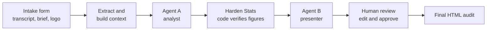
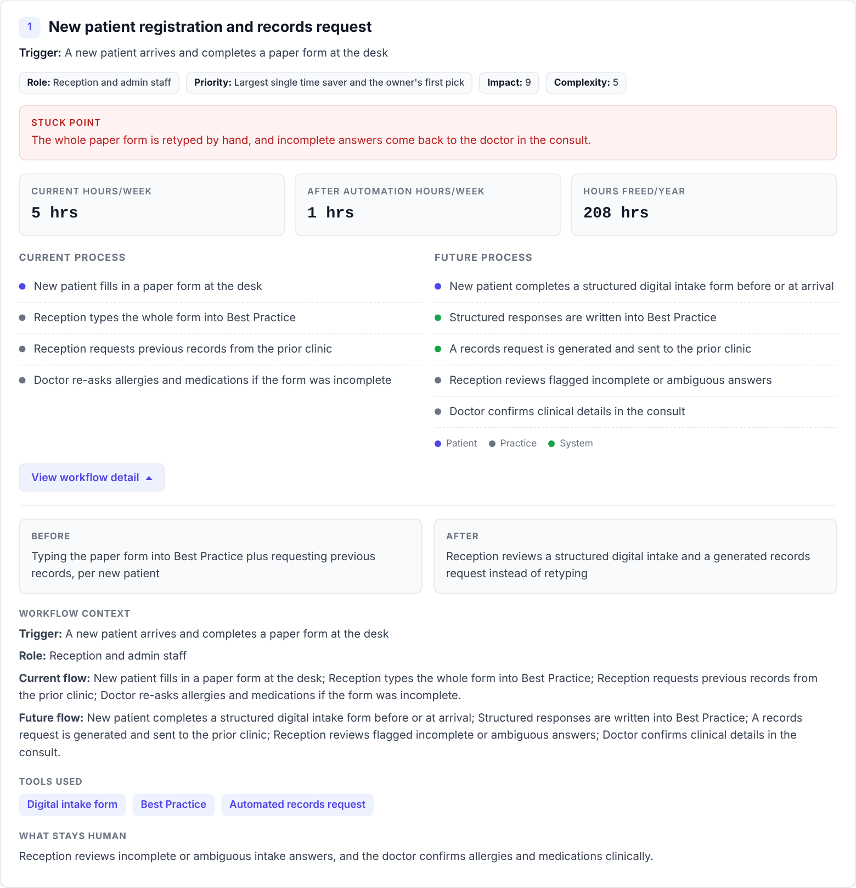

# OpenAudit

**Turn a discovery-call transcript into a client-ready, interactive automation audit.**

OpenAudit is an n8n pipeline I designed and built solo during my AI & Automation internship at Eloize. You upload a sales or discovery call transcript, and it produces a self-contained HTML audit: where the client's staff time goes, it picks the best automations worth doing first, and how many hours each one frees. Then you can edit the final HTML before it's finished.

**[View the live example audit →](https://aaronkal-ecu.github.io/open-audit/examples/wade-court/output.html)**

## Used on a real client

OpenAudit produced the audit Eloize pitched to a Perth food-delivery business. After seeing it, the client hired Eloize to automate parts of the business's systems.

That audit covered:

| | |
|---|---|
| Workflows quantified | 3, plus 5 supporting flows and 1 next-phase item |
| Pain points identified | 4 |
| Manual handling today | ~67 hrs/yr |
| After automation | ~19 hrs/yr |
| Time freed | **~48 hrs/yr, a 72% reduction** |

Client details are withheld. [Full breakdown →](docs/using-openaudit.md#3-real-client-perth-food-delivery-business)

## What it does

1. **Intake.** An n8n form takes the transcript, any supporting documents, the client logo, the labour rate and an optional engagement brief.
2. **Extraction.** PDFs and text files are extracted and assembled into one context block, with the transcript first as the primary evidence.
3. **Agent A, the analyst.** It reads the material and returns strict JSON: the three strongest workflows, pain points, supporting flows, next-phase items and the raw inputs for every figure. Each claim is marked `verified` or `estimate`.
4. **Harden Stats.** A code node recomputes every hours figure, total and percentage from those raw inputs, rejects impossible values and resolves the headline KPIs. The model never does the arithmetic that reaches the client.
5. **Agent B, the presenter.** It builds a single-file interactive dashboard from the hardened data, with charts, expandable workflow cards and before/after process maps.
6. **Human review.** The submitter is redirected to an in-browser editor. Nothing is final until a person approves it, and the approved file is re-validated before download.

## Design principles

- **The LLM judges, code does the maths, a human approves.** Language models are good at reading a messy conversation and deciding what matters, and unreliable at sums. Each job goes to the part that does it well. [More in design decisions](docs/design-decisions.md).
- **Hours first.** The audit leads with time freed, not invented dollar savings.
- **Honest confidence.** Every figure carries a `VERIFIED` or `EST.` marker traced back to the transcript.
- **Grounded, not padded.** Exactly three quantified workflows. Smaller ideas become supporting flows with no figures attached.

## See it in action

Every screenshot below comes from one real run of the workflow on the [Wade Court example](examples/wade-court): a made-up discovery call with the owner of a four-doctor GP practice whose three admin staff spend most of the day retyping paperwork. From that one 35-minute call, OpenAudit found **~464 hours a year** of admin time that could be freed, a **72% reduction**. You can [open the finished audit](examples/wade-court/output.html) yourself.

### 1. The pipeline

This is the whole workflow inside n8n, read from left to right. The left third takes the uploaded files apart and turns them into text the AI can read. The middle is the two AI agents with the **Harden Stats** code check between them. The right side is the review step that holds the audit until someone approves it. The small group underneath serves the review page when it's opened. [Every node is explained here.](docs/architecture.md)

### 2. Starting an audit

The consultant fills in this form after the discovery call: the client's name, the call transcript, the logo, the labour rate and, optionally, an engagement brief that pins down facts the AI must not get wrong. Nothing else is needed. [How to write a brief.](docs/using-openaudit.md#1-steering-an-audit-the-engagement-brief)

### 3. Reviewing before it ships

After a few minutes the form opens the generated audit in review mode. Any text can be corrected by clicking on it, and nothing is final until **Approve & Finalise** is pressed. This keeps a person responsible for everything the client sees.

### 4. The finished audit

The output is a single HTML file the client can open in any browser, with no login and nothing to install. It walks them from the problem to the proposed fix:

**The summary.** A plain-English overview of the business, what it already does well, and the main thing holding it back.

**Where the time goes.** Each pain point from the call, how much time it costs, and which proposed workflow fixes it.

**The proposed workflows.** Each of the three workflows gets a card showing the hours it frees, today's process next to the automated one, the tools involved, and what stays with a person. Colour-coded dots show who does each step: the patient, the practice or the system.

**The numbers side by side.** Hours spent today against hours after automation, for each workflow. Every figure here was calculated by code, not by the AI.

**What's next.** Questions the client raised that fall outside the first three workflows get a considered answer and the conditions for revisiting them. Here, that's whether to open online telehealth bookings.

## Quick start

1. Import [`workflows/openaudit-v4.1.json`](workflows/openaudit-v4.1.json) into n8n.
2. Add your DeepSeek API key to the two agent nodes.
3. Put your n8n address in the **Build Review Page** node, then activate the workflow.
4. Open the form and submit the files in [`examples/wade-court`](examples/wade-court).

Step-by-step instructions and fixes for common errors are in the [setup guide](docs/setup.md).

## What's in this repo

| Folder | Contents |
|---|---|
| [`workflows/`](workflows) | The workflow to import (`openaudit-v4.1.json`) and the original August 2026 version (`openaudit-v1.json`), kept for history |
| [`examples/wade-court/`](examples/wade-court) | The example transcript, engagement brief, logo and the audit it produced |
| [`docs/`](docs) | The guides listed below, plus screenshots |

## Further reading

- [How it works](docs/architecture.md): every stage and node, in order
- [Why it's built this way](docs/design-decisions.md): the reasoning behind the key choices
- [Setup guide](docs/setup.md): import, credentials and your first audit
- [Using OpenAudit](docs/using-openaudit.md): writing an engagement brief, the full Wade Court results, and the real client audit

## Built with

n8n · DeepSeek API (the original client run used Claude Sonnet) · JavaScript · Chart.js

## Author

**Aaron Mark Kalaji**, Software Engineering student at Edith Cowan University, Perth. [GitHub](https://github.com/AaronKal-ECU)

Released under the [MIT License](LICENSE).
