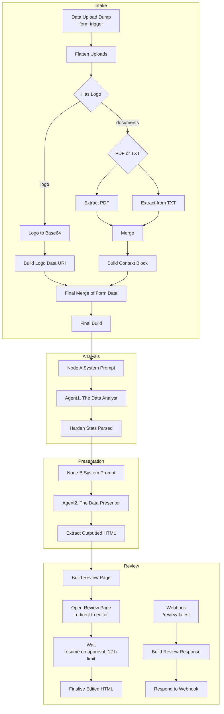

# Architecture

OpenAudit v4.1 is a single n8n workflow of 25 nodes. It runs in two parts: a **generation run** triggered by the intake form, and a **review loop** that pauses the run until a person approves the audit.

## Stage 1: Intake

| Node | What it does |
|---|---|
| **Data Upload Dump** | n8n form. It takes the company name, recipient, transcript (.md, .txt or .pdf), currency, an optional engagement brief, optional supporting documents, one or more logos, the labour rate and the location. |
| **Flatten Uploads** | Turns the form's binary fields into one item per file, labelled `TRANSCRIPT`, `REFERENCE` or `LOGO`. It handles n8n's `_0`, `_1` suffixes when several files share one field. |
| **Has Logo / PDF or TXT** | Route each file: logos go to image handling, documents to the matching extractor. |
| **Extract PDF / Extract from TXT** | n8n's built-in text extraction. |
| **Build Context Block** | Re-pairs extracted text with its label and filename, because the extractors drop both. It puts the transcript first, since the analyst weights what it reads first, then joins everything into one labelled block. |
| **Logo to Base64 / Build Logo Data URI** | Convert each logo to a `data:` URI so the final audit is a single file with no external images. |
| **Final Build** | Combines the context block, logos, form fields, labour rate, currency symbol and engagement brief into the one object the analyst consumes. |

## Stage 2: Analysis

| Node | What it does |
|---|---|
| **Node A System Prompt** | Holds the analyst's system prompt, the user prompt (engagement brief plus context block), the model name and `max_tokens`. |
| **Agent1, The Data Analyst** | Calls DeepSeek's chat completions endpoint in JSON mode. It returns one JSON package: business context, three quantified workflows (current and future steps, before/after hours per occurrence, occurrences per year, impact and complexity scores), supporting flows, pain points, key indicators, next-phase items and a presentation brief. |
| **Harden Stats Parsed** | The integrity layer. See below. |

### What Harden Stats does

The analyst supplies only raw inputs. Every figure that reaches the client is computed here, in code:

1. **Parse and salvage.** It finds the text in the model response, strips code fences, and repairs stray quotes or raw newlines inside JSON strings without reordering or dropping content. A response cut off at `max_tokens` fails with a clear message.
2. **Validate the structure.** There must be exactly three workflows. Each supporting flow must link to a real parent and carry no figures. `after` hours can never exceed `before`, occurrences must be between 1 and 10,000, and scores must be integers from 1 to 10.
3. **Recompute.** It calculates per-workflow current, future and saved hours per year and per week, plus the reduction percentage, then audit-wide totals and working days freed (at 7.6 hours a day).
4. **Police money.** A currency figure is allowed only where the client actually stated one and only in narrative fields. It is rejected anywhere in totals, KPIs, core workflow figures or supporting flows. The audit is hours first by design.
5. **Resolve headline KPIs.** The analyst only chooses *which* metric to feature; this step writes in the verified value, so a stale number can't ride along in prose.
6. **Re-inject form data.** Business name and logo flags come from Final Build. The logo bytes never pass through a model prompt.

## Stage 3: Presentation

| Node | What it does |
|---|---|
| **Node B System Prompt** | The presenter's rules: section order, fixed palette, interactivity requirements, accessibility, print styles, and "display every figure exactly as given". |
| **Agent2, The Data Presenter** | Receives the hardened JSON and returns one complete HTML document with inline CSS and JS and Chart.js charts. Logos appear only as the placeholder `__LOGO_DATA_URI__`. |
| **Extract Outputted HTML** | Checks the response is a complete document (`<!DOCTYPE html>` through `</html>`), checks the placeholder count matches the logos uploaded, swaps in the real logo data and names the file after the business. |

## Stage 4: Review

| Node | What it does |
|---|---|
| **Build Review Page** | Wraps the audit in an `<iframe srcdoc>` editor so the dashboard's styles and the editor never collide. Text becomes editable, and an Approve button posts the edited document back to the run's resume URL. A snapshot is saved to workflow static data. |
| **Open Review Page** | The form's completion step. It redirects the submitter straight to the editor. |
| **Wait** | Pauses the execution until the Approve POST arrives, for up to 12 hours. |
| **Finalise Edited HTML** | Strips the editor markup, re-runs the HTML integrity checks on the approved version and emits the final file for download. |
| **Webhook → Build Review Response → Respond to Webhook** | A separate entry point at `/webhook/review-latest` that serves the latest pending review, or a clear "already approved" or "expired" page, so a reused link never shows a dead editor. |

## Data contract between the agents

Agent A and Agent B never talk directly. The hardened JSON is the only interface, which means:

- the presenter can be swapped, restyled or re-prompted without touching the analysis;
- every number in the dashboard can be traced to one field in one object;
- a failed presentation run can be retried without paying for the analysis again.
