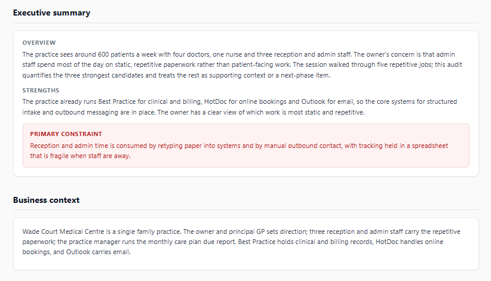
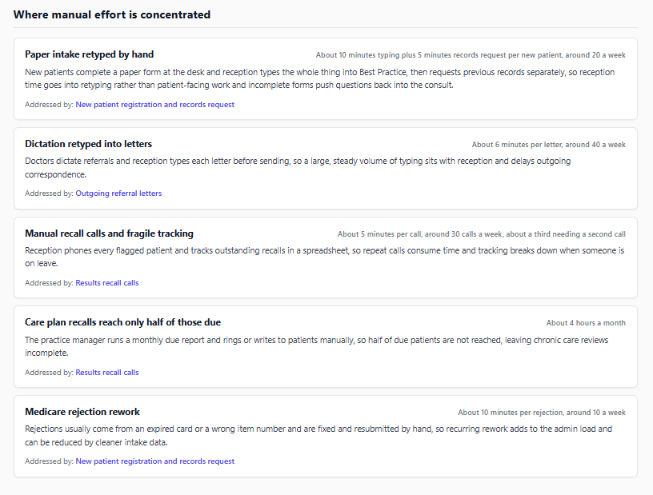
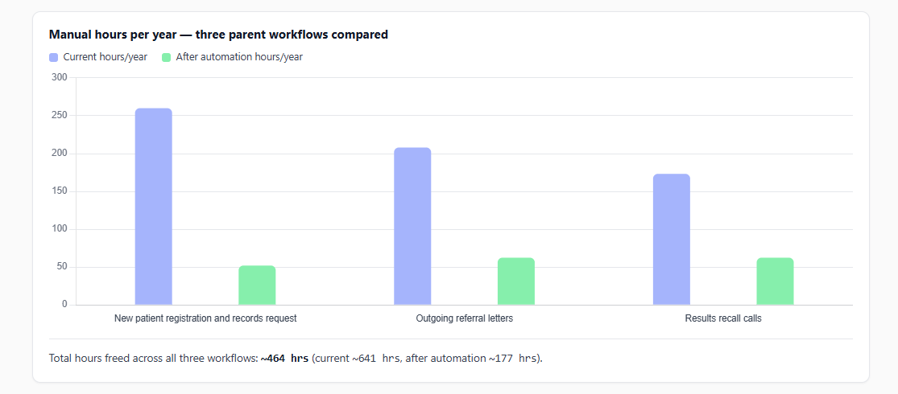
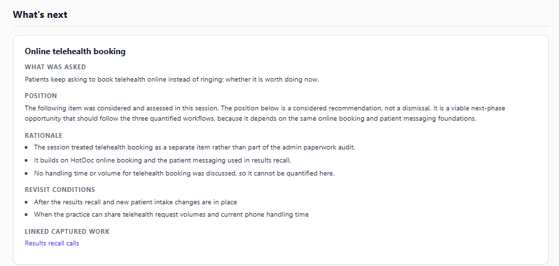

# Using OpenAudit

This guide covers how to steer an audit with an engagement brief, a worked example, and how OpenAudit performed on a real client.

## 1. Steering an audit: the engagement brief

A transcript is messy evidence. Speaker labels are wrong, figures get corrected mid-call, and the client's real priority is often implied rather than said. The optional **Engagement brief** form field lets the consultant pin down what must hold true, without touching any prompts.

The analyst treats the brief as **client facts checked against the transcript**. Where the two conflict, the brief wins. Leave it empty and OpenAudit works from the transcript alone.

Use it to set:

- **Framing:** what the audit is for and what must stay human.
- **Client questions:** anything the client asked to have answered. These become next-phase items.
- **Workflow candidates:** the journeys to choose the three quantified workflows from.
- **Fixed facts:** handling times and volumes per channel, so figures aren't borrowed between workflows.
- **Existing tools:** so proposed tools come from what the client already runs.

### Template

```text
ENGAGEMENT FRAMING
<Who the client is, what the audit is for, what must stay human.>

QUESTIONS THE CLIENT ASKED
1. <A question to answer as a next-phase item.>

WORKFLOW CANDIDATES
- <Journey 1: trigger and the manual work involved.>
- <Journey 2>
- <Journey 3>
- <Journey 4>

CLIENT FACTS (checked against the transcript)
- <Workflow>: <minutes> (<hours> hrs) each, about <n> a week.
- <Workflow>: <minutes> each, about <n> a week.
- Existing tools: <tool>, <tool>, <tool>.
```

Give minutes and hours side by side (for example `10 minutes (0.167 hrs)`) so the analyst never has to convert.

## 2. Example: Wade Court Medical Centre

A synthetic discovery call between me and the owner of a four-doctor GP practice. His main concern: three capable admin staff spend most of the day on static, repetitive paperwork instead of looking after patients. The practice name honours my family's former practice, and everything in the call is fictional.

**Inputs:** [transcript](../examples/wade-court/transcript.md) · [engagement brief](../examples/wade-court/engagement-brief.md) · [logo](../examples/wade-court/logo.jpg)
**Output:** [generated audit](../examples/wade-court/output.html), approved without edits

| | |
|---|---|
| Manual hours per week today | ~12.3 hrs |
| Current hours per year | ~641 hrs |
| After automation | ~177 hrs |
| Hours freed per year | **~464 hrs, a 72% reduction** |
| Working days freed | ~61.1 days (7.6-hour day) |

| Workflow | Current | After | Freed | Impact / complexity |
|---|---|---|---|---|
| New patient registration and records request | 260 hrs/yr | 52 hrs/yr | 208 hrs/yr | 9 / 5 |
| Outgoing referral letters | 208 hrs/yr | 62.4 hrs/yr | 145.6 hrs/yr | 8 / 5 |
| Results recall calls | 173.2 hrs/yr | 62.4 hrs/yr | 110.8 hrs/yr | 7 / 4 |

The session raised five repetitive jobs. OpenAudit quantified the three strongest, kept care plan recalls and Medicare rejections as pain points linked to those workflows, and turned the client's telehealth question into a next-phase item.









## 3. Real client: Perth food-delivery business

OpenAudit's first production run produced the audit Eloize pitched to a Perth food-delivery business that was absorbing a second business. The client then hired Eloize to automate parts of the business's systems. Names, people and branding are withheld. The figures below are the code-verified figures from the generated audit.

**Scope:** 3 quantified workflows · 4 pain points · 5 supporting flows · 1 next-phase item

| Workflow | Current | After | Impact / complexity |
|---|---|---|---|
| Provider referral intake | 30.9 hrs/yr | 5.5 hrs/yr | 8 / 3 |
| Walk-in and phone intake | 19.5 hrs/yr | 6.6 hrs/yr | 6 / 5 |
| Website enquiry intake | 16.4 hrs/yr | 6.6 hrs/yr | 5 / 4 |
| **Total** | **~67 hrs/yr** | **~19 hrs/yr** | **~48 hrs/yr freed, 72%** |

**Volume basis:** about five new enquiries a week across three intake channels, split roughly 70% provider referral, 15% walk-in and 15% website, plus about 20 manual follow-up messages a week kept separate from intake. Referral intake alone ran at about 182 forms a year, at 10 minutes each.

**What the audit found**

- Two parallel manual intake pipelines doing the same rule-based work: creating records, applying discount codes and making first contact.
- Walk-in and phone intake took up to 30 minutes per contact, with no digital pre-qualification.
- Website enquiries arrived incomplete, which forced a manual follow-up loop before intake could start.
- Re-engagement after a first order relied on staff remembering to export data and send messages by hand.

**What it proposed:** a structured referral form that creates the customer record and applies the right discount code automatically, a digital pre-qualification step for walk-in and phone customers, and website form validation with an automatic acknowledgement. Staff handle only exceptions. Relationship support and eligibility judgement stay human.

This run used Claude Sonnet for both agents. The public version uses DeepSeek.
